# Zacess Games

Fourteen original games for the terminal, drawn in the eight [Zacess](https://zacess.com) high
contrast themes. Each game is written in Rust with its levels in Lua and is built on
[Zacess Scenes](https://github.com/zacesshq/scenes), so the games share the scenes' themes,
contrast floors, flash limit and reduced motion.

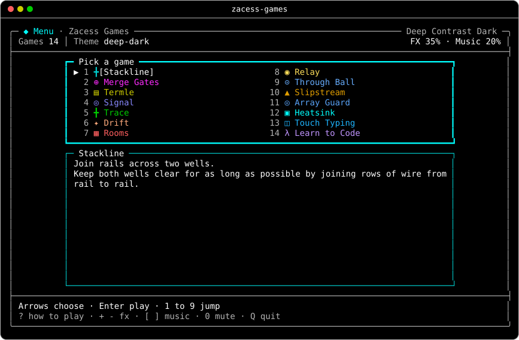

## What every game has

- **Zacess themes with contrast floors.** Every colour keeps at least 4.5 to 1 contrast on the
  theme's background. The High Contrast and Deep Contrast themes keep at least 7 to 1.
- **No flashing.** Every frame passes through the Scenes flash meter. Reduced motion is honoured
  from a flag, an environment variable and the system setting.
- **Sound effects and calm music**, synthesised by the game itself. Each has its own volume and
  both can be muted. Every sound has a written twin on screen.
- **A how-to-play page** behind `?` (`F1` in the typing games), so the rules are never more than
  one key away.
- **Levels in Lua**, so a level can be read, changed and shared without building anything.

## Quick start

```sh
zacess-games                  # the menu
zacess-games trace            # one game by name; a short start such as "stack" is enough
zacess-games list             # every game and its best score
zacess-games sounds           # every effect, then each game's music
```

In most games `Space` pauses, `?` shows how to play, `+` and `-` set the effects, `]` and `[` the
music and `0` mutes. `Q` or `Esc` goes back to the menu and `Ctrl+C` always leaves.

## The games

Every game is its own design. None copies an existing game's rules, board or goal.

| Game | What it is |
| --- | --- |
| [Stackline](docs/how-to-play.md#stackline) | Circuit parts fall into two wells. A full row whose parts all carry wire across joins the rails and clears, pushing a feedback row with one break into the other well |
| [Merge Gates](docs/how-to-play.md#merge-gates) | Push four-bit tiles together through a track of logic gates to make the target output |
| [Termle](docs/how-to-play.md#termle) | A daily electronics or programming term from a category clue and arrow feedback, with a streak for days in a row |
| [Signal](docs/how-to-play.md#signal) | A calm rhythm game: catch notes on three lanes as they reach the line |
| [Trace](docs/how-to-play.md#trace) | Route wire from a source to light every node without crossing, with vias and one-way nodes |
| [Drift](docs/how-to-play.md#drift) | Steer a lantern over a quiet landscape to gather light. There is no way to lose |
| [Rooms](docs/how-to-play.md#rooms) | A short roguelike through a broken server: carry parts to faults to open the doors |
| [Relay](docs/how-to-play.md#relay) | Move a packet through gates that keep time with the move count, portals and one-way tiles |
| [Through Ball](docs/how-to-play.md#through-ball) | Turn-based football about passing lanes and a keeper's reach, over five attacks |
| [Slipstream](docs/how-to-play.md#slipstream) | A calm road race against the fuel gauge, with slipstreams and a pit lane |
| [Array Guard](docs/how-to-play.md#array-guard) | Clear drifting debris to protect five satellite dishes, with shields, capsules and waves |
| [Heatsink](docs/how-to-play.md#heatsink) | Type electronics terms and code fragments before they reach a chip and heat it, with a calm mode |
| [Touch Typing](docs/how-to-play.md#touch-typing) | A trainer from the home row to timed tests, with an on-screen keyboard showing the finger for every key. It follows the keyboard in use (UK Mac, UK PC or US), read from the system |
| [Learn to Code](docs/how-to-play.md#learn-to-code) | Fifteen tracks from first steps to job-ready: Python, Java, C, C++, JavaScript, TypeScript, SQL, Bash and Linux, Git, Rust, Go, C#, Kotlin, Data Structures and Algorithms and AI in Python. Fill in small programs with hints, teaching messages and saved progress |

Every still is Zacess Deep Contrast Dark at 100 by 30, part way through a game.

| | | |
| --- | --- | --- |
| 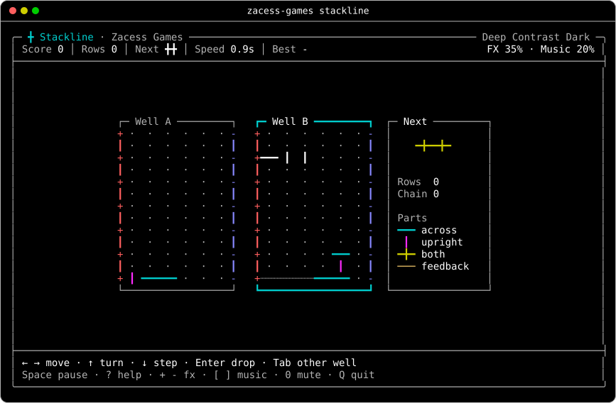<br>Stackline | 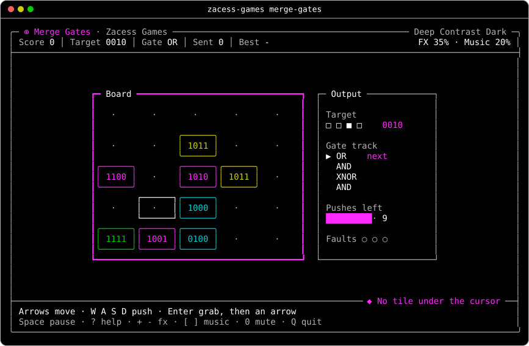<br>Merge Gates | 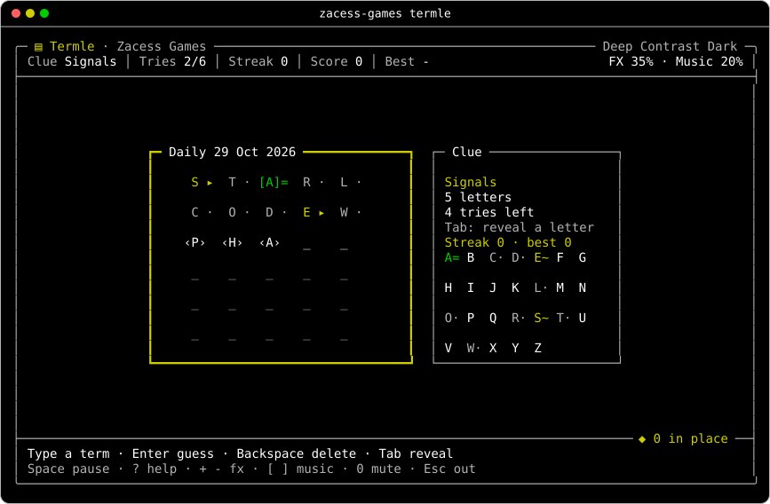<br>Termle |
| 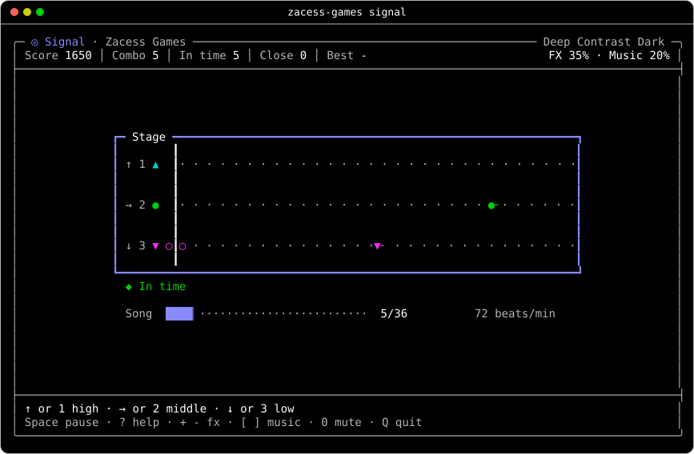<br>Signal | 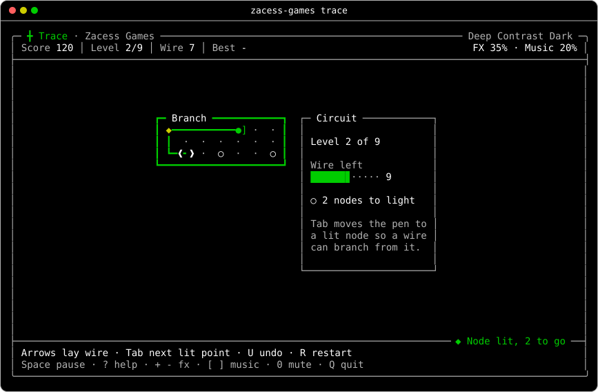<br>Trace | 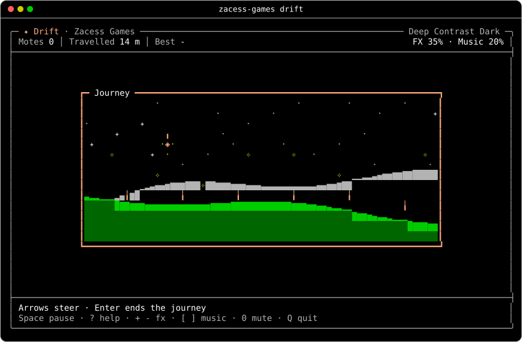<br>Drift |
| 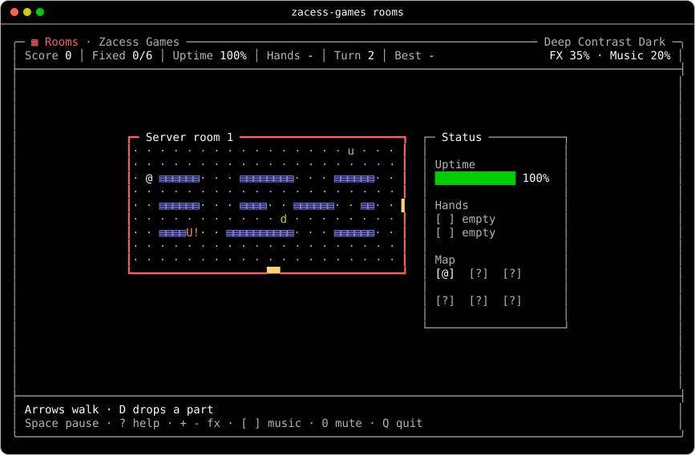<br>Rooms | 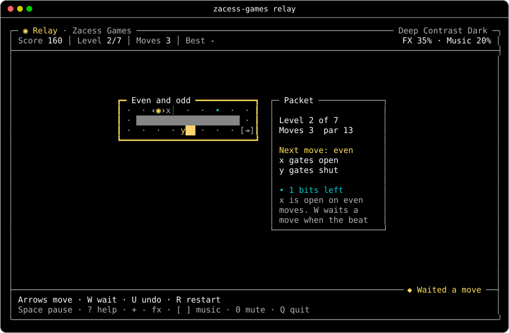<br>Relay | 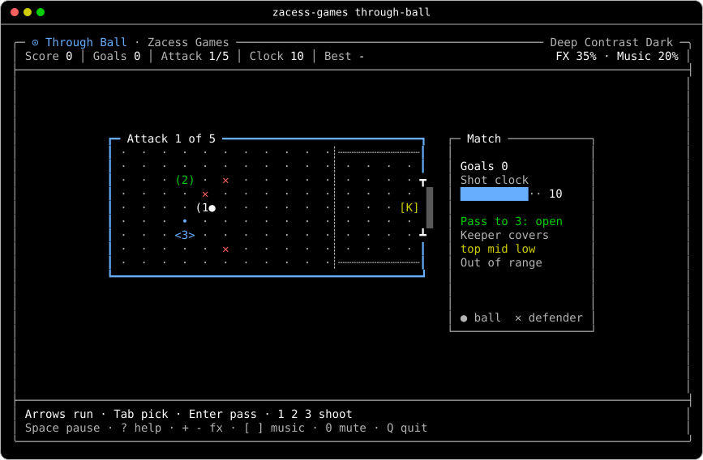<br>Through Ball |
| 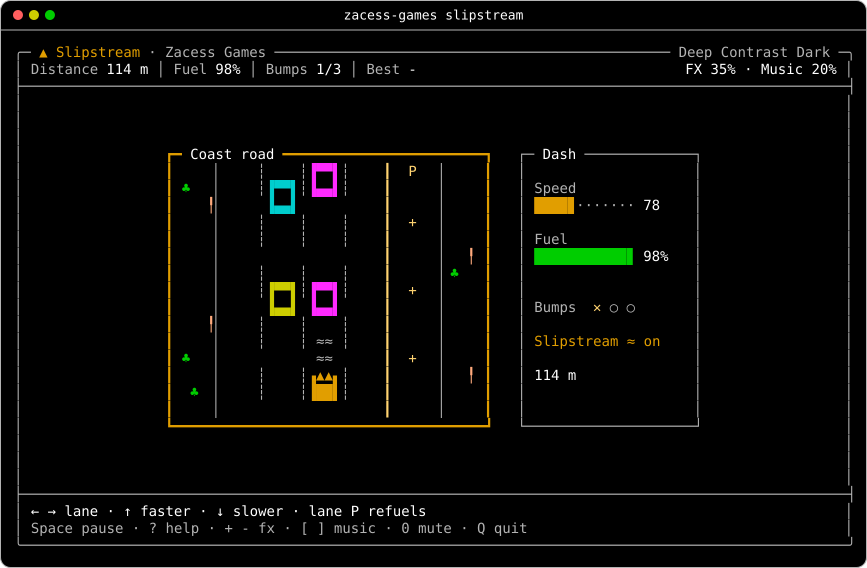<br>Slipstream | 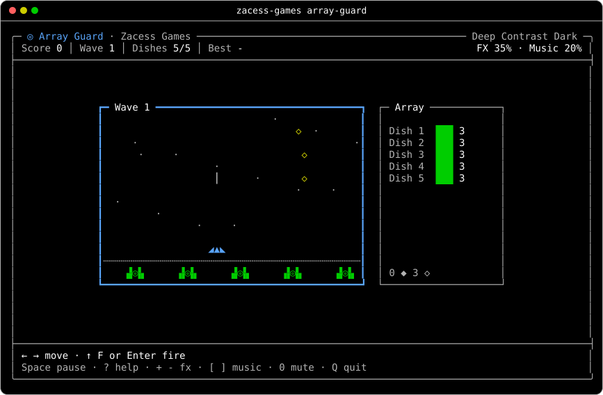<br>Array Guard | 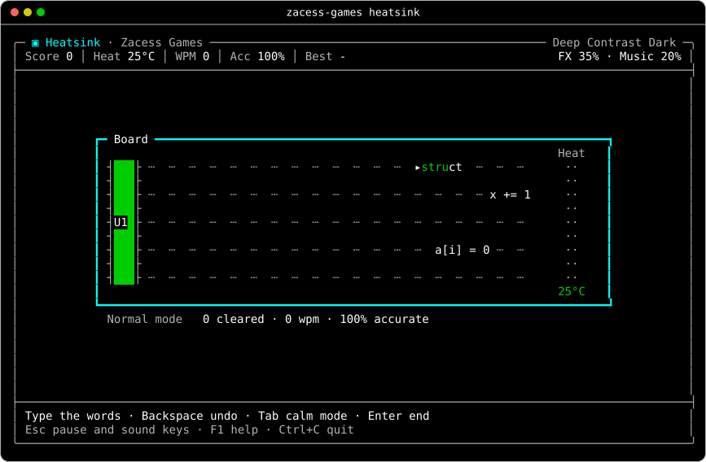<br>Heatsink |
| 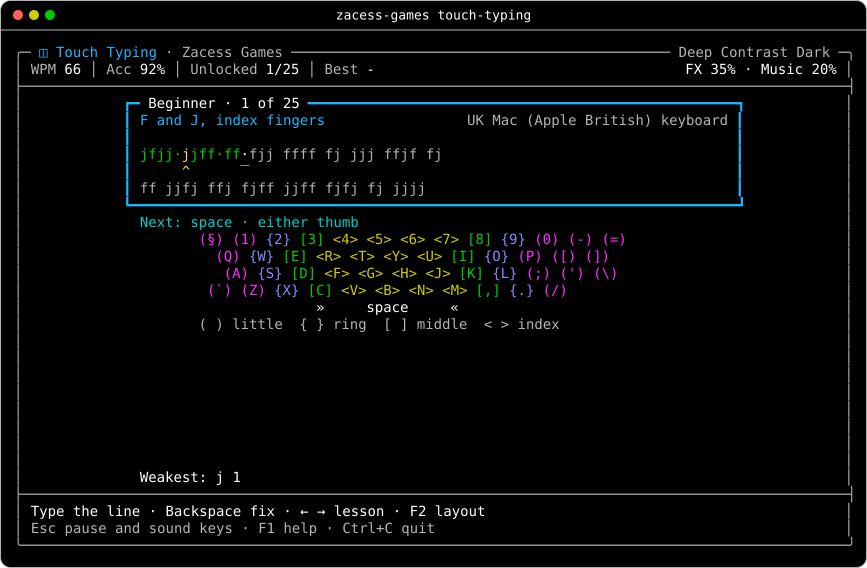<br>Touch Typing | 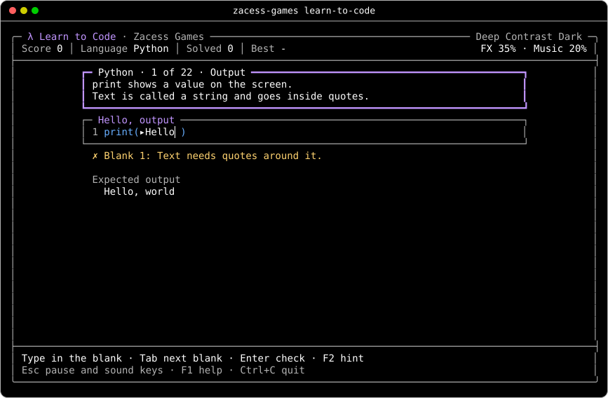<br>Learn to Code |   |

Every game also has a still in Zacess Light in [`docs/images`](docs/images/), with a few in other
themes and in the compact and large layouts.

## Install

### With Cargo

The games are not on crates.io, so Cargo installs them from this repository:

```sh
cargo install --locked --git https://github.com/zacesshq/games zacess-games
```

Rust 1.88 or later and a C compiler, since Lua 5.4 is built into the program. Sound is played by
the system's own player (`afplay` on macOS, PipeWire, PulseAudio or ALSA on Linux and PowerShell on
Windows), so nothing else is needed.

### From a release

Each [release](https://github.com/zacesshq/games/releases/latest) will carry a built binary for
macOS, Linux and Windows with a SHA-256 file beside it, in the same way as the
[Zacess Scenes releases](https://github.com/zacesshq/scenes/releases/latest).

## Documentation

| Page | Covers |
| --- | --- |
| [How to play](docs/how-to-play.md) | The goal, rules, scoring, winning and losing, a tip and the keys of every game, with a still of each |
| [Controls](docs/controls.md) | Every key, command, flag, variable, setting and window size on one sheet |
| [Accessibility](ACCESSIBILITY.md) | What the games do on screen, in sound and at the keyboard |
| [Contributing](CONTRIBUTING.md) | How a change is made, the checks, adding a game and releasing |

## Levels in Lua

Trace and Relay read their levels from Lua files and Learn to Code reads its tracks from them. A
Trace or Relay file returns one level or a list, each with a `name`, a `note`, a `map` of strings
and a `budget` (Trace) or `par` (Relay). A Learn to Code file returns a track: a language, an id
and its levels, each with a lesson, code lines with blanks, the answers each blank takes, a hint,
the mistakes it teaches about and the program's output. The format is described at the top of each
built-in file in [`levels/`](levels/).

Extra files go in a folder named after the game under `~/.config/zacess/games`
(`%APPDATA%\zacess\games` on Windows) and play after the built-in ones. A file runs in a sandbox
like the one Scenes gives its Lua scenes: no file, process, network or module access, a memory cap
and an instruction budget. Learn to Code checks answers against each level's own list inside the
game. Nothing typed is ever run as a program.

## Scores and progress

Best scores, the Termle streak, the Touch Typing lessons unlocked, the Learn to Code progress for
each language and the sound settings live in `~/.local/state/zacess-games/scores.txt`
(`$XDG_STATE_HOME/zacess-games` when that is set and `%LOCALAPPDATA%\zacess-games` on Windows). One
`key value` pair a line, so the file can be read or cleared by hand.

## Accessibility

Zacess products are built for people with low vision, light sensitivity and motion sensitivity
first. Every game keeps the theme's contrast floor, never flashes and slows down under reduced
motion. Neither colour nor sound is ever the only signal and every game can be paused at any
moment. The full statement is in [ACCESSIBILITY.md](ACCESSIBILITY.md).

## Contributing

See [CONTRIBUTING.md](CONTRIBUTING.md). Ideas for a game are welcome through the
[game idea form](https://github.com/zacesshq/games/issues/new?template=game_idea.yml).

## Licence

[MIT](LICENSE). The licence does not cover the Zacess name or mark; see [NOTICE.md](NOTICE.md).
